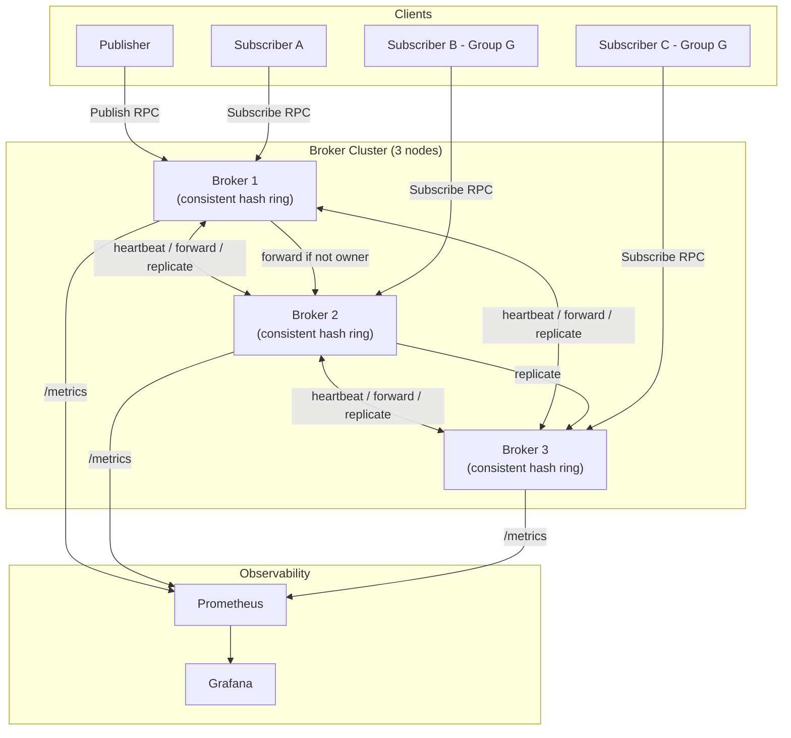

# Beacon Architecture

## High-Level Overview



## Consistent Hash Ring

```
Ring positions (0 → 2³²−1, wraps around):

                        0
                        │
              ┌─────────┴──────────┐
     B3-vn47  ●                    ● B1-vn12
              │        Ring        │
     B2-vn99  ●                    ● B3-vn3
              │                    │
              └─────────┬──────────┘
                        │
                     B2-vn55

Topic "orders" hashes to position X.
Walk clockwise → first vnode hit is the primary owner.
Continue clockwise, skip same node → first different node is the replica.
```

## Message Lifecycle (at-least-once)

```
Publisher
  │
  ▼
Publish RPC
  │
  ├─ Am I the owner? ─── No ──► ForwardPublish to owner node
  │
  └─ Yes
      │
      ▼
  Assign seq_num (atomic increment)
      │
      ▼
  Write to ring buffer (evicts oldest if full)
      │
      ▼
  Fan-out to all matching subscribers
      │  (backpressure policy applies per subscriber)
      ▼
  Start retry timer (per subscriber, per seq_num)
      │
      ▼
  Subscriber ACKs → cancel timer
  Timer fires     → re-deliver (at-least-once)
```

## Consumer Groups

```
Topic "payments" — seq_nums 1,2,3,4 —►

Group "billing":
  Member A ← seq 1, 3   (round-robin / least-loaded)
  Member B ← seq 2, 4

Group "" (no group):
  Member C ← seq 1,2,3,4  (all messages)
  Member D ← seq 1,2,3,4  (all messages)
```

## Failure Detection & Replica Promotion

```
Epoch 1:
  B1 (owner of "orders") ←── heartbeat ──► B2 (replica)
  B1 ←── heartbeat ──► B3

B1 crashes (heartbeat timeout fires on B2):

Epoch 2 election:
  B2 observes silence > HeartbeatTimeout
  B2 increments epoch → 2
  B2 announces itself as new owner via JoinCluster broadcast
  Other nodes accept only if epoch ≥ their known epoch (prevents split-brain)

B2 now serves "orders" reads and writes.
B3 becomes the new replica.
```

## Package Dependency Graph

```
cmd/broker
    │
    ├── internal/broker      (core engine)
    │       ├── internal/config
    │       └── internal/metrics
    ├── internal/cluster     (consistent hash ring)
    │       └── (no internal deps)
    ├── internal/replication (Phase 3)
    │       └── proto/pubsubv1
    └── proto/pubsubv1       (generated gRPC stubs)
```
